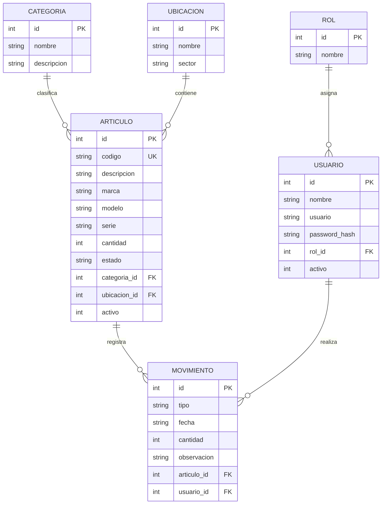

# Modelo de datos

## Diagrama entidad-relación

## Tablas y relaciones
- **Rol:** identifica el perfil y sus permisos generales. Un rol puede asignarse a muchos usuarios.
- **Usuario:** almacena nombre, nombre de usuario, hash de contraseña, rol y estado activo. Un usuario puede registrar muchos movimientos.
- **Categoría:** clasifica artículos, por ejemplo computadoras, periféricos, componentes, red, herramientas e insumos.
- **Ubicación:** indica el lugar físico o sector donde se encuentra el artículo.
- **Artículo:** contiene código único, descripción, marca, modelo, serie, cantidad, estado, categoría, ubicación y marca lógica de activo.
- **Movimiento:** conserva tipo, fecha, cantidad, observación, artículo relacionado y usuario responsable.

## Claves y validaciones
- Cada tabla posee una clave primaria `id`.
- `articulos.codigo` y `usuarios.usuario` son únicos.
- Las claves foráneas conectan las tablas relacionadas.
- La cantidad no puede ser negativa.
- La baja de un artículo se realiza de forma lógica para conservar su historial.
- Las contraseñas se guardan con hash, no como texto plano.
